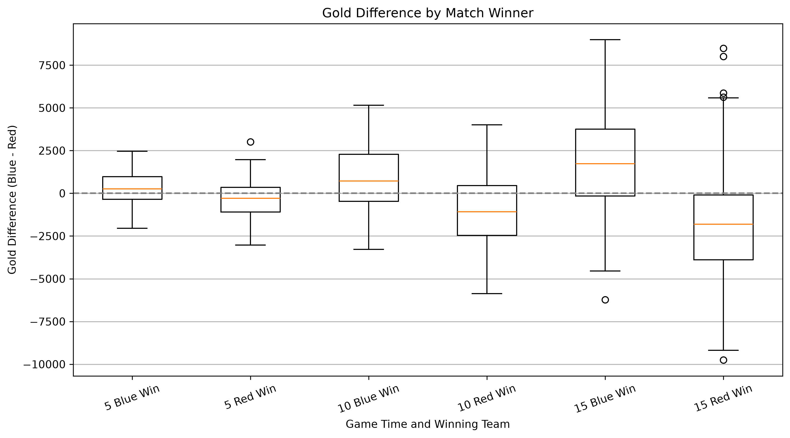
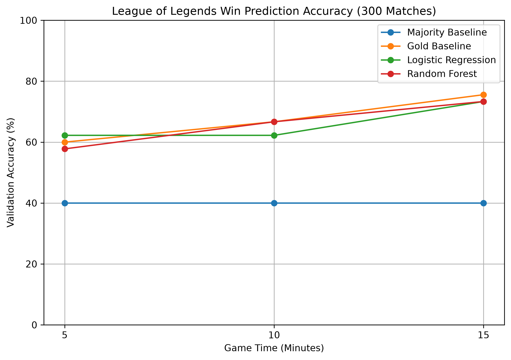
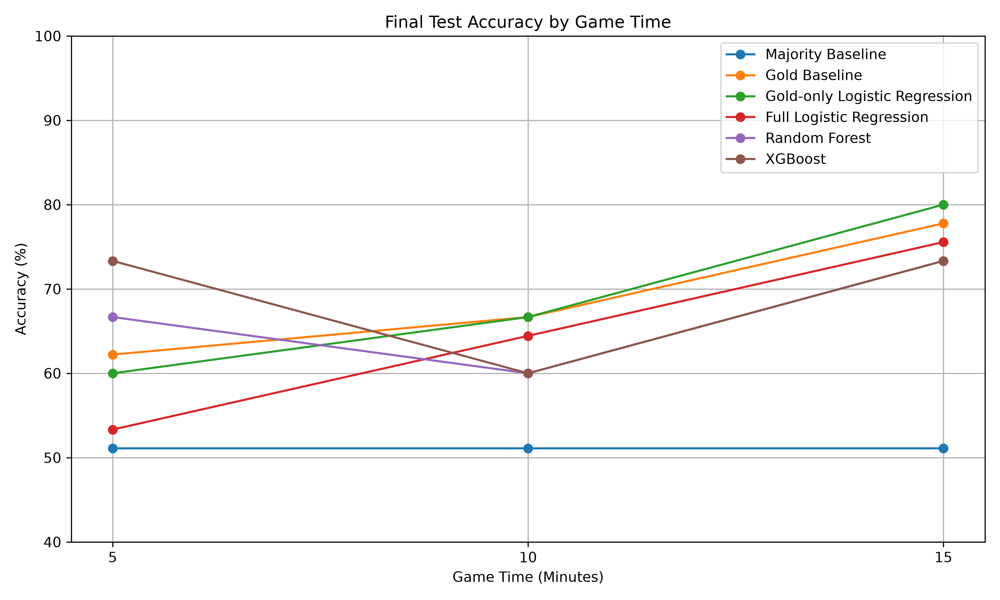
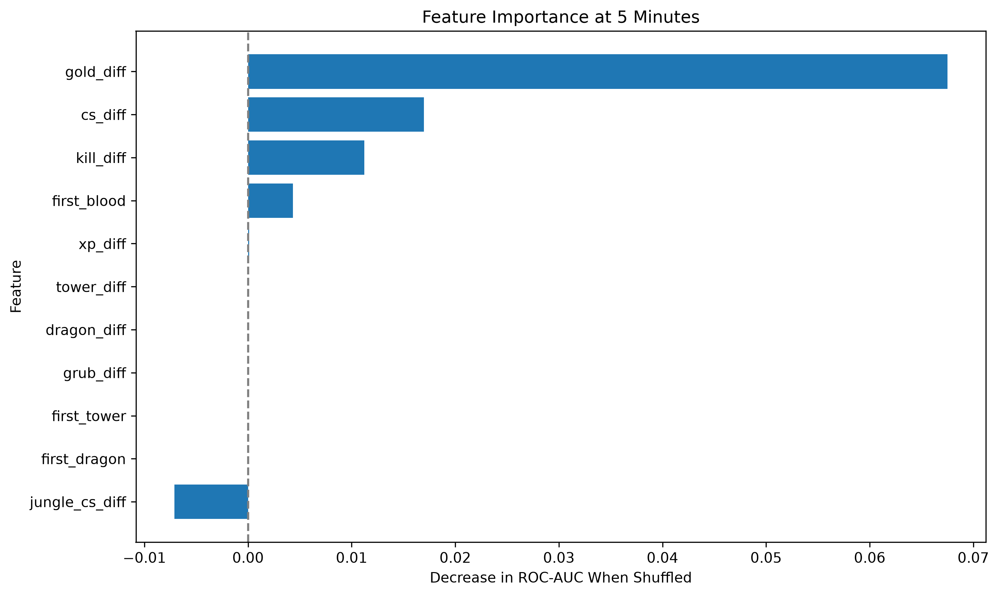
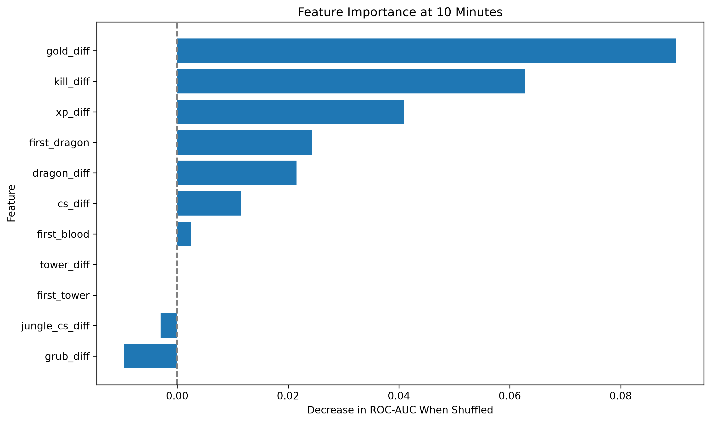
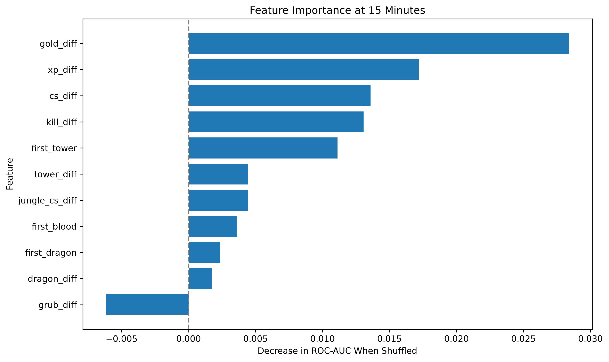

# league-win-predictor
**When Is a League of Legends Game Decided?**

Predicting Match Outcomes from Early Game Data

## Project Description

League of Legends is a competitive 5 vs 5 game where teams gain advantages through gold, experience, kills, objectives, towers, and other in game events. Although players often describe games as being "won" or "lost" early, it is usually not always clear how early the final result actually becomes predictable. 

The goal of this project is to use real League of Legends match data to determine how accurately the winner of a ranked match can be predicted from the state of the game at approximately 5, 10, and 15 minutes.

Using the official Riot Games API, I will collect ranked match histories and timeline data. For each match, I will reconstruct the game state at these three time points and extract features like gold difference, experience differece, lane cs difference, jungle cs difference, kill difference, tower difference, dragon difference, early objective difference, first blood, first tower, first dragon, and role specific gold differences. I will then train machine learning models to predict whether the Blue or Red team eventually wins the game. 

A secondary part of the project will investigate which early game advantages and events are most strongly associated with a team's probability of winning. For example, the analysis might examine whether gold difference is more informative than kill difference, how useful first blood is as a predictor, or whether an early gold lead in one role is more important than a similar lead in another role. 

The project forcuses on 2 main questions:
1. How accurately can the winner of a League of Legends match be predicted at 5, 10, and 15 minutes?
2. Which early game features are most strongly associated with winning?

## Motivation

I chose this project because I regularly play League of Legends in my free time and am interested in understanding the game through data instead of relying only on player intuition. I also realized that a League of Legends match can be a useful data science problem because no single statistic completely describes which team is winning. A team could have more kills but less gold, more gold but fewer objectives, or an early advantage that disappears later in game. I've noticed in my own games that I feel like we were winning in the early game but ended up losing the match. 

## Project Goals

Primary Goal

The primary goal of the project is to predict the winner of a ranked League of Legends match using only information available at approximately 5, 10, 15 minutes.

I will evaluate the prediction problem separately at each time point. This will allow me to compare questions like:<br>
How accurately can the winner be predicted after only 5 minutes?<br>
How much does prediction improve by 10 minutes?<br>
How predictable is the winner by 15 minutes?<br>
The main measureable result will be the performance of the trained models on matches that were not used during training. 

Secondary Goal

The secondary goal is to determine which early game features and events are most strongly associated with the probability of eventually winning the match. 

Questions I will investigate include:<br>
Is gold difference more predictive than kill difference?<br>
How useful is XP difference?<br>
How strongly is first blood associated with winning?<br>
How important is first tower?<br>
How important is first dragon?<br>
Do early objective advantages improve prediction?<br>
Are gold advantages in some roles more informative than others?<br>
How much does model confidence increase between 5, 10, and 15 minutes?<br>
Because this project uses observational match data, these results will be interpreted as associations rather than proof of causation.

## Data Collection Plan

Data Source

The primary data source will be the official Riot Games API.<br>
The project will use League of Legends match and timeline data to obtain ranked match IDs, match results, participant information, match timelines, and timestamped in game events.<br>
The timeline also provides events and statistics that can be used to reconstruct the match state, including total gold, XP, minions killed, jungle minions killed, champion kills, first blood, dragons, void grubs, rift herald, towers, baron, and more. 

Dataset

The initial dataset will focus on:<br>
Region: North America<br>
Game Mode: Ranked Solo/Duo<br>
Patch Range: Limited set of recent patches<br>
Target Size: Around 5000-10000 matches

## Collection Method

A Python program will be written to automatically collect data from the Riot Games API. The collection process will follow:

Seed Players -> Retrieve PUUIDs -> Retrieve Ranked Match IDs -> Download Match Information -> Download Match Timelines -> Extract Additional Players -> Collect Additional Matches

Each match contains information about the players who participated in it. These players can be used to discover additional ranked matches, allowing the dataset to grow without manually entering thousands of player names. 

Match IDs will be tracked so that duplicate games are not downloaded or processed multiple times. Raw API data will be stored separately from processed data so that the cleaning and feature extraction steps can be reproduced.

Data Cleaning and Feature Extraction

Collected matches will be cleaned before being used for modeling.

Possible cleaning steps will be removing duplicate matches, removing non Ranked Solo/Duo matches, removing remakes or unusually short matches, removing matches with missing timeline data, removing incomplete or invalid API responses, restricting matches to the selected patch range, and ensuring usable 5, 10, and 15 minute timeline frames exist.

For each valid match, features will then be calculated at approximately 5, 10, and 15 minutes. Many features will be represented as the difference between 2 teams.

For example:<br>
gold_difference = blue_team_gold - red_team_gold

Extracted Features will include:<br>
Gold Difference - Blue team gold minus Red team gold<br>
XP Difference - Blue team XP minus Red team XP<br>
Lane CS Difference - Difference in lane minions killed<br>
Jungle CS Difference - Difference in jungle monsters killed<br>
Kill Difference - Blue kills minus Red kills<br>
Tower Difference - Difference in towers destroyed<br>
Dragon Difference - Difference in Dragons taken<br>
Early Objective Difference - Difference in early neutral objectives<br>
First Blood - Which team earned first blood<br>
First Tower - Which team destroyed the first tower<br>
First Dragon - Which team killed the first dragon<br>
Role Gold Differences - Gold differences between corresponding roles

The prediction target will be: <br>
blue_win = 1 if Blue wins<br>
blue_win = 0 if Red wins

## Preliminary Modeling Plan

The project will begin with a simple baseline before testing more advanced models.

Models will most likely include:<br>
Baseline, Logistic Regression, Random Forest, and Gradient Boosted Trees.

## Model Evaluation Plan

The collected matches will be divided into separate training, validation, and testing groups.

The split will look something like this:<br>
70% training<br>
15% Validation<br>
15% Final Testing<br>
The split will occur at the match level, meaning that all observations from the same game must remain in the same partition. For example, the 5, 10, and 15 minute data from one match will never be divided between training and testing. If practical, the split will also be chronological so that models are trained on older matches and evaluated on newer matches. The final test data will not be used while selecting models or features.<br>
The most important comparison will be how prediction performance changes between the 5, 10, and 15 minute models.

## Planned Visualizations

Prediction Performance Over Time

A graph of prediction performance over time will compare model performance at 5, 10 and 15 minutes. This will directly help answer the question, when does a League of Legends match become reasonably predictable?

Feature Importance

The project will visualize which features contribute most strongly to predictions, such as gold difference, XP difference, kill difference, tower difference, dragon difference, and first blood.

Match Win Probability Visualization

As an extension, the model will be used to visualize predicted win probability throughout an individual match. Important events such as dragons, towers, first blood, or baron could be marked on the graph to show how the predicted outcome changes throughout the game.

## Project Timeline

The project is planned over approximately 8 weeks:<br>
Week 1 - Finalize Proposal<br>
Week 2 - Build automated match and timeline collection scripts<br>
Week 3 - Begin large scale data collection and duplicate handling<br>
Week 4 - Finish primary data collection, clean matches, and build feature extraction<br>
Week 5 - Perform exploratory data analysis, create preliminary visualizations, and train baseline models<br>
Week 6 - Train and compare Logistic Regression, Random Forest, and gradient boosted models<br>
Week 7 - Analyze model performance, feature importance, and win probability visualizations<br>
Week 8 - Final testing, reproducibility checks, and project cleanup

## Challenges and Fallback Plan

Possible challenges include Riot API rate limits, incomplete match data, changes between League patches, and the time required to collect thousands of matches. 

If the original project scope becomes too large, the fallback project will focus on the primary research question only.

The minimum successful version of the project will collect several thousand Ranked Solo/Duo matches, extract features at approximately 5, 10, and 15 minutes, train a baseline model and at least 1 machine learning model, compare prediction performance across the 3 timestamps, analyze which early game features are most informative, and create clear visualization of the results.<br>
More advanced analysis, such as continuous win probability graphs or detailed role specific modeling, can be treated as extensions if time allows.

## Repository

The project will be maintained using Git and GitHub throughout development. The repository will contain the code needed for data collection, data cleaning, feature extraction, model training, model evaluation, and visualization. The final repository will also include documentation explaining how to install dependencies and reproduce the results. Riot API credentials and other private information will not be committed to GitHub.

## Progress Update - October 2026

## Data Collection and Processing

So far, I have collected 312 League of Legends matches using the Riot Games API. Out of these, 300 matches are from the most recent patch 16.20 and are included in the current dataset. For each match, I extracted game statistics at approximately 5, 10, and 15 minutes. This gives me 900 observations from 300 unique matches.

The features include gold difference, XP difference, lane CS difference, jungle CS difference, kill difference, tower difference, dragon difference, Void Grub difference, first blood, first tower, and first dragon.

I divided the matches chronologically into 3 groups:<br>
Training: 210 matches (70%)<br>
Validation: 45 matches (15%)<br>
Testing: 45 matches (15%)<br>
All 3 observations from the same match stay in the same group. I also saved the match IDs so that the split remains consistent. The final test set has not been used for evaluation yet.

## Preliminary Model Results

I implemented 3 prediction methods:<br>
Majority baseline: Always predicts the side that won more frequently in the training set.<br>
Gold baseline: Predicts the team with more gold at the selected minute.<br>
Logistic Regression: Uses all 11 extracted features to predict the winning team.<br>
The current validation accuracy results are:<br>
Majority Baseline - 40.00% for 5 min | 40.00% for 10 min | 40.00% for 15 min<br>
Gold Baseline - 60.00% for 5 min | 66.67% for 10 min | 75.56% for 15 min<br>
Logistic Regression - 62.22% for 5 min | 62.22% for 10 min | 73.33% for 15 min

The preliminary results suggest that match outcomes become easier to predict as the game progresses. The gold baseline and Logistic Regression model perform similarly, while the gold baseline achieving slightly higher accuracy at 10 and 15 minutes. I also evaluated Logistic Regression using ROC-AUC, log loss, and Brier score. Its ROC-AUC improved from 0.7366 at 5 minutes to 0.7963 at 15 minutes.

## Confidence Intervals

I used 5000 bootstrap samples to estimate 95% confidence intervals for validation accuracy. For the gold baseline, accuracy improved from 60.00% at 5 minutes to 75.56% at 15 minutes. The estimated improvement was 15.56 percentage points with a 95% bootstrap confidence interval 0.00 to 31.11 percentage points. For Logistic Regression, accuracy improved from 62.22% at 5 minutes to 73.33% at 15 minutes. The estimated improvement was 11.11 percentage points with a 95% bootstrap confidence interval of -2.22 to 24.44 percentage points. Because these intervals include or touch 0, I cannot confidently conclude that the improvements are statistically significant yet. I plan to evaluate this further with a larger dataset.

## Data Validation

I created scripts to check the processed dataset against the original Riot timeline JSON files. The dataset currently has no missing values or duplicate match-minute observations. All 300 matches have observations at all 3 timestamps. The numerical feature audit and first event audit both reported 0 mismatches across 900 observations. The current snapshots are slightly after the requested minutes, with a maximum difference of 420 milliseconds. I am treating these as approximate 5, 10, and 15 minute snapshots. The event audits also found that First Blood was recorded by 5 minutes in every sampled match and First Dragon by 15 minutes in every sampled match. I plan to inspect these unusually consistent patterns more closely before drawing conclusions from them.

## Current Limitations and Next Steps

The current results are preliminary because the validation set contains only 45 matches. Matches may also share players, which means the observations may not be completely independent.

My next steps are to:<br>
Check the earliest objective event timestamps and investigate unusual event distributions.<br>
Expand the dataset while keeping the final test set fixed.<br>
Add more exploratory visualizations.<br>
Test additional models such as Random Forest.<br>
Investigate which early game features are most useful for predicting the winner.<br>
Perform final evaluation on the untouched test set after model selection is complete.<br>

## Progress Update - November 2026

## Exploratory Data Analysis

Since the October check-in, I created additional visualizations to explore the relationship between early-game statistics and match outcomes. I first compared gold differences between matches won by Blue and Red teams at 5, 10, and 15 minutes. The median gold difference for matches won by Blue increased from +264 at 5 minutes to +1734.5 at 15 minutes. For matches won by Red, the median changed from -293 to -1815. These results suggest that teams that eventually win generally have larger gold advantages as the game progresses.

## Random Forest Model

I also implemented a Random Forest model using the same 11 features as Logistic Regression. I trained separate models at 5, 10, and 15 minutes using the same training and validation matches from October.

Majority Baseline - 40.00% (5 minutes) | 40.00% (10 minutes) | 40.00% (15 minutes)<br>
Gold Baseline - 60.00% (5 minutes) | 66.67% (10 minutes) | 75.56% (15 minutes)<br>
Logistic Regression - 62.22% (5 minutes) | 62.22% (10 minutes) | 73.33% (15 minutes)<br>
Random Forest - 57.78% (5 minutes) | 66.67% (10 minutes) | 73.33% (15 minutes)

Random Forest performed similarly to Logistic Regression in terms of accuracy. However, Random Forest achieved higher ROC-AUC socres at 10 and 15 minutes, respectively. 

## Feature Importance

I used permutation importance to investigate which features contributed the most to Random Forest predictions. The results shows that gold difference ranked highest at all three timestamps. At 5 minutes, CS difference and kill difference were the next most useful features. At 10 minutes, kill difference and XP difference ranked second and third. At 15 minutes, XP difference and CS difference ranked second and third. These results suggest that gold difference is an important predictor, although the importance estimates may be affected by correlated features and the small validation sample. 

## Additional Data Validation

I also checked the timestamps of First Blood and First Dragon events in the original Riot timeline files. The reported events were consistent with the earlier first_event audit results. However, there are still some timestamp-handling details I want to verify before finalizing the dataset.

I also checked whether any events occurred between the exact 5, 10, and 15 minute timestamps and the selected Riot timeline snapshots. Out of 900 observations, 12 included events that happened slightly after the exact minute. The largest timestamp difference was 420 milliseconds. Because the game statistics come from Riot's recorded frames, I am treating these as approximate 5, 10, and 15 minute predictions rather than exact-minute predictions. All included events occurred by the actual snapshot time. 

## Next Steps

My next steps are to imporve the reliability of my results, finish checking the timestamps, and compare additional models such as XGBoost. I also want to investigate how well models generalize to matches from newer patches. After choosing my final modleing approach, I plan to evaluate it using the untouched test set and finish the reproducibility instructions for the project.

## Final Project Results

### Final Dataset

The final dataset consists of 300 Ranked Solo/Duo matches from the North America region with game version 16.20. For each match, I extracted statistics at approximately 5, 10, and 15 minutes, giving a total of 900 observations.

The dataset contains 148 matches won by Blue and 152 matches won by Red. There are no missing values, duplicate observations, or matches with missing snapshots.

The final dataset is smaller than originally planned. I decided to focus on validating the existing data and completing the model comparisons rather than expanding the dataset.

### Data Processing and Validation

The 11 features used in the full models are:

- `gold_diff` - Gold difference
- `xp_diff` - XP difference
- `cs_diff` - Lane CS difference
- `jungle_cs_diff` - Jungle CS difference
- `kill_diff` - Kill difference
- `tower_diff` - Tower difference
- `dragon_diff` - Dragon difference
- `grub_diff` - Void Grub difference
- `first_blood` - Team that earned first blood
- `first_tower` - Team that destroyed the first tower
- `first_dragon` - Team that killed the first dragon

The differences are calculated as Blue team values minus Red team values. The prediction target is `blue_win`, where 1 represents a Blue team win and 0 represents a Red team win.

I checked the processed features against the original timeline files and found no mismatches in the numerical feature and first event audits. I also checked the event timestamps. There were 1029 events with a timestamp of 0, but none were champion kills, special champion kills, monster kills, or building kills.

The maximum difference between the requested minute and the selected snapshot was 420 milliseconds. There were 12 observations with events between the exact minute and the selected snapshot. Because of this, the project uses approximate 5, 10, and 15 minute predictions based on the actual timeline frames.

### Exploratory Data Analysis

I compared the gold differences of matches won by Blue and Red at each of the 3 timestamps.

| Winning Team | 5 Minutes | 10 Minutes | 15 Minutes |
|---|---:|---:|---:|
| Blue (median gold difference) | 264 | 718 | 1734.5 |
| Red (median gold difference) | -293 | -1073.5 | -1815 |

The results suggest that teams that eventually win generally have larger gold advantages as the game progresses.



### Final Modeling Methods

I implemented 6 prediction methods:

- Majority Baseline - Predicts the team side that won more frequently in the training set.
- Gold Baseline - Predicts the team with more gold at the selected minute. Ties use the majority baseline.
- Gold-only Logistic Regression - Uses only gold difference to predict the winning team.
- Full Logistic Regression - Uses all 11 extracted features.
- Random Forest - Uses 100 decision trees with a maximum depth of 5 and a minimum of 3 samples per leaf.
- XGBoost - Uses 100 boosted trees with a maximum depth of 3, a learning rate of 0.05, and row and feature sampling rates of 0.8.

For both Logistic Regression models, I standardized the features using the training data. The same scaling was then applied to the evaluation data.

### Validation Results

During model development, I divided the matches chronologically into 3 groups:

- Training: 210 matches (70%)
- Validation: 45 matches (15%)
- Testing: 45 matches (15%)

All 3 observations from the same match were kept in the same group. The match IDs for each group were saved so that all models used the same split.

| Model | 5 Minutes | 10 Minutes | 15 Minutes |
|---|---:|---:|---:|
| Majority Baseline | 40.00% | 40.00% | 40.00% |
| Gold Baseline | 60.00% | 66.67% | 75.56% |
| Gold-only Logistic Regression | 57.78% | 60.00% | 71.11% |
| Full Logistic Regression | 62.22% | 62.22% | 73.33% |
| Random Forest | 57.78% | 66.67% | 73.33% |
| XGBoost | 62.22% | 66.67% | 73.33% |



I used 5000 paired bootstrap samples to compare the validation accuracy of the gold baseline, full Logistic Regression, and Random Forest. All of the 95% confidence intervals for their accuracy differences included or touched 0. I could not confidently conclude that one method performed better than the others.

### Final Test Evaluation

After completing the model comparisons, I combined the training and validation sets to train the final models using 255 matches. I then evaluated them using the original 45 test matches.

Separate models were trained at approximately 5, 10, and 15 minutes. The model settings were not changed after observing the final test results.

### Final Test Accuracy

| Model | 5 Minutes | 10 Minutes | 15 Minutes |
|---|---:|---:|---:|
| Majority Baseline | 51.11% | 51.11% | 51.11% |
| Gold Baseline | 62.22% | 66.67% | 77.78% |
| Gold-only Logistic Regression | 60.00% | 66.67% | 80.00% |
| Full Logistic Regression | 53.33% | 64.44% | 75.56% |
| Random Forest | 66.67% | 60.00% | 73.33% |
| XGBoost | 73.33% | 60.00% | 73.33% |



At 5 minutes, XGBoost achieved the highest accuracy of 73.33%. At 10 minutes, the gold baseline and gold-only Logistic Regression both achieved an accuracy of 66.67%. At 15 minutes, gold-only Logistic Regression achieved the highest accuracy of 80.00%.

Most prediction methods performed better at 15 minutes than at 5 minutes.

### Additional Evaluation Metrics

I also used ROC-AUC, log loss, and Brier score to evaluate the machine learning models. A higher ROC-AUC and lower log loss and Brier score are generally better.

#### ROC-AUC

| Model | 5 Minutes | 10 Minutes | 15 Minutes |
|---|---:|---:|---:|
| Gold-only Logistic Regression | 0.6640 | 0.7470 | 0.8538 |
| Full Logistic Regression | 0.6344 | 0.7095 | 0.7905 |
| Random Forest | 0.6621 | 0.6462 | 0.8063 |
| XGBoost | 0.6640 | 0.6542 | 0.7727 |

#### Log Loss

| Model | 5 Minutes | 10 Minutes | 15 Minutes |
|---|---:|---:|---:|
| Gold-only Logistic Regression | 0.6405 | 0.5967 | 0.4992 |
| Full Logistic Regression | 0.6626 | 0.6356 | 0.5558 |
| Random Forest | 0.6758 | 0.6685 | 0.5438 |
| XGBoost | 0.6905 | 0.6789 | 0.5648 |

#### Brier Score

| Model | 5 Minutes | 10 Minutes | 15 Minutes |
|---|---:|---:|---:|
| Gold-only Logistic Regression | 0.2255 | 0.2051 | 0.1636 |
| Full Logistic Regression | 0.2363 | 0.2195 | 0.1868 |
| Random Forest | 0.2378 | 0.2370 | 0.1822 |
| XGBoost | 0.2384 | 0.2391 | 0.1917 |

Gold-only Logistic Regression achieved the highest ROC-AUC and the lowest log loss and Brier score at 15 minutes. Although XGBoost achieved the highest accuracy at 5 minutes, its other evaluation metrics were not as strong.

### Final Confidence Intervals

I calculated 95% Wilson confidence intervals for the test accuracy of each prediction method. The results at 15 minutes were:

| Model | Correct Predictions | Accuracy | 95% Confidence Interval |
|---|---:|---:|---|
| Majority Baseline | 23/45 | 51.11% | 37.00% to 65.04% |
| Gold Baseline | 35/45 | 77.78% | 63.73% to 87.46% |
| Gold-only Logistic Regression | 36/45 | 80.00% | 66.18% to 89.10% |
| Full Logistic Regression | 34/45 | 75.56% | 61.33% to 85.76% |
| Random Forest | 33/45 | 73.33% | 58.96% to 84.04% |
| XGBoost | 33/45 | 73.33% | 58.96% to 84.04% |

Because the test set only contains 45 matches, the confidence intervals are relatively wide. Gold-only Logistic Regression achieved the highest observed accuracy, but these individual intervals do not establish whether it is better than the other models.

### Feature Importance

I used permutation importance on the validation set to investigate which features were most useful for Random Forest predictions. I shuffled each feature 20 times and measured the average decrease in ROC-AUC.

| Timestamp | Most Important | Second | Third |
|---|---|---|---|
| 5 Minutes | Gold Difference | CS Difference | Kill Difference |
| 10 Minutes | Gold Difference | Kill Difference | XP Difference |
| 15 Minutes | Gold Difference | XP Difference | CS Difference |







Gold difference had the highest importance score at all 3 timestamps. Other features such as XP difference, kill difference, and CS difference also contributed to predictions. These results describe the trained model and may be affected by correlated features and the small validation set.

### Conclusion

The primary goal of this project was to determine how early the winner of a League of Legends match can be predicted.

The results generally showed that match outcomes became easier to predict as the game progressed. For example, gold-only Logistic Regression improved from 60.00% accuracy at 5 minutes to 66.67% at 10 minutes and 80.00% at 15 minutes.

One of the most interesting findings was that more complicated models did not consistently perform better than simpler models. The gold baseline and gold-only Logistic Regression performed competitively with Random Forest and XGBoost despite only using gold difference.

The feature importance results also showed that gold difference was the most useful feature for Random Forest predictions at all 3 timestamps. This does not necessarily mean that other features are not important because some of these features may contain similar information to gold difference.

Overall, the results suggest that gold difference is an important predictor of winning and that the final outcome generally becomes more predictable as the match progresses. However, this does not mean that the outcome of a match is already decided at 15 minutes.

### Limitations and Future Work

The biggest limitation of this project is the size of the dataset. Although I used 900 observations, these observations only came from 300 unique matches. The final test set only contained 45 matches.

Another limitation is that all matches came from the same patch. The results may be different for other patches or different groups of players. Some matches may also share players, meaning that the matches may not be completely independent. The confidence intervals do not account for this possible dependence.

The timeline snapshots are also slightly after the exact 5, 10, and 15 minute timestamps, with a maximum difference of 420 milliseconds.

If I were to continue this project, I would collect more matches, evaluate the models on different patches and ranks, and investigate whether role specific gold differences provide additional information. I would also investigate how predicted win probabilities change throughout individual matches.

### Reproducing the Project

The processed dataset and saved match splits are included in the repository. This allows the modeling experiments to be reproduced without collecting new matches from the Riot Games API.

The project was developed using Python 3.14 on an Apple Silicon Mac.

Clone the repository:

```bash
git clone https://github.com/matthewrhee02/league-win-predictor.git
cd league-win-predictor
```

Create and activate a virtual environment:

```bash
python3 -m venv .venv
source .venv/bin/activate
```

On macOS, XGBoost may require OpenMP. If Homebrew is installed, run:

```bash
brew install libomp
```

Install the required packages:

```bash
python -m pip install -r requirements.txt
```

The following Makefile commands can be used:

| Command | Description |
|---|---|
| `make validate` | Validates the processed dataset |
| `make models` | Reproduces the validation model results |
| `make plots` | Generates the project visualizations |
| `make final` | Reproduces the final test results and confidence intervals |
| `make all` | Runs validation, models, and visualizations |

The original raw match and timeline files are not included in the repository. The data collection and feature extraction scripts are included, but reproducing the original data collection and raw data audits requires additional data and access to the Riot Games API where applicable. Riot API credentials are not included in the repository.